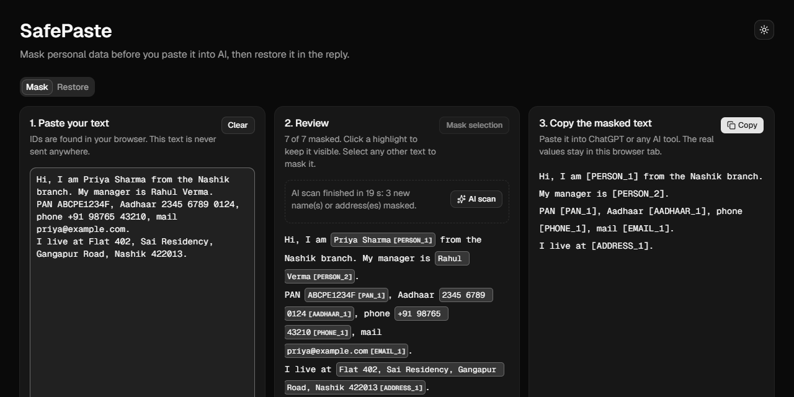
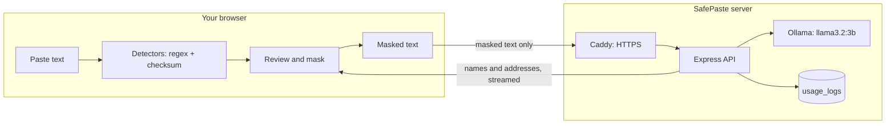
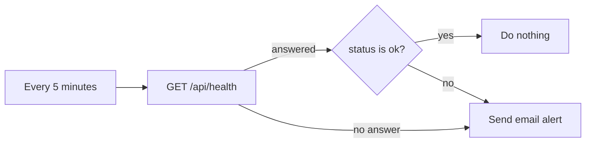
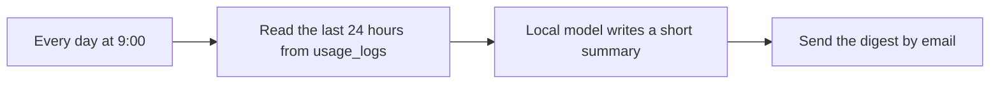

# SafePaste

**Use AI on text that contains personal data, without handing that data to the AI.**

SafePaste masks personal data, including Indian IDs such as Aadhaar, PAN, GSTIN and UPI, before you paste text into ChatGPT or any other AI tool. Afterwards it puts the real values back into the AI's reply.

**Live:** https://trysafepaste.vercel.app



## How to use it

1. **Paste** your text. IDs such as PAN, Aadhaar, card and phone numbers are highlighted at once.
2. **Review.** Click a highlight to keep it visible, or select any other text and press **Mask selection**.
3. **AI scan** (optional). SafePaste's own model finds names and addresses, and the highlights appear one by one.
4. **Copy** the masked text and paste it into your AI tool.
5. **Restore.** Paste the AI's reply into the Restore tab, and the tags turn back into the real values.

```text
You paste:       Hi, I am Priya Sharma. PAN ABCPE1234F, phone +91 98765 43210.
The AI sees:     Hi, I am [PERSON_1]. PAN [PAN_1], phone [PHONE_1].
The AI replies:  Dear [PERSON_1], your PAN [PAN_1] is verified.
You get back:    Dear Priya Sharma, your PAN ABCPE1234F is verified.
```

## Why it is different

- **Built for Indian IDs.** Aadhaar, PAN, GSTIN and UPI are checked with their real checksum rules (Verhoeff, Luhn, mod-36), not only by shape, so random numbers are not flagged.
- **IDs never leave your browser.** Detection and masking run on your device, in a Web Worker.
- **The AI is our own.** Names and addresses are found by an open model on SafePaste's own server. No outside AI company is involved, and the model only ever receives the already-masked text.
- **The model cannot make things up.** A name or address is kept only if it appears word for word in your text.
- **A full round trip.** Restoring works even when the AI rewrites a tag as `PERSON_1`, `{PERSON_1}` or `[Person 1]`.
- **Nothing is stored.** No account, no saved text, no IP addresses. Reload the page and everything is gone.
- **Works without the server.** If the AI server is down, masking by rules still works.

## How it works



The website is a static site on Vercel, so Vercel never sees pasted text. The browser calls the API directly.

## What it detects

| Type | Found by | Rule |
|---|---|---|
| GSTIN | Browser | State code + PAN + entity + `Z` + mod-36 check character |
| Aadhaar | Browser | 12 digits, first digit 2–9, Verhoeff check digit |
| Card | Browser | 13–19 digits, Luhn check |
| PAN | Browser | `AAAAA9999A`, 4th letter one of `PCHFATBLJG` |
| UPI | Browser | `name@handle` with a known handle (okaxis, ybl, paytm, …) |
| Email | Browser | Standard address format |
| Phone | Browser | Optional `+91` or `0`, then 10 digits starting 6–9 |
| Person, Address | AI scan | Self-hosted model, then the word-for-word check |
| Anything else | You | Select the text and press **Mask selection** |

When two matches overlap, the one higher in the table wins. For example, the PAN inside a GSTIN is not reported twice.

## Privacy and protection

- The pasted text and the tag map (`[PAN_1]` → real value) live only in the memory of the browser tab.
- The API never logs or stores request text. Its usage log has no column for it.
- Instead of the IP address, the log stores a hash of IP + date + a secret. It changes every day, so visitors can be counted but not followed.
- API limits: Cloudflare Turnstile check on every request, CORS allowlist, 10 requests per minute per IP, 1,000-character input limit, a queue (1 running, 2 waiting) and a 45-second timeout.

## Automation

Two [n8n](https://n8n.io) workflows run on the server. Their files are in [`n8n/`](n8n/) and contain no secrets.

**Health check** ([`n8n/health-check.json`](n8n/health-check.json)): emails the owner when the API is down.



**Daily digest** ([`n8n/daily-digest.json`](n8n/daily-digest.json)): database → local AI → email.



A cron job also pokes the model every 20 minutes so it stays loaded. A scan then takes a few seconds instead of waiting about 14 seconds for the model to load.

## Tech stack

| Part | Built with |
|---|---|
| Web app | Next.js 16 (App Router, static export), TypeScript, Redux Toolkit, Tailwind CSS v4, shadcn/ui |
| API (`server/`) | Express 5, TypeScript run directly by Node, Server-Sent Events |
| AI | Ollama with `llama3.2:3b` on a 2-core Arm server |
| Server | Oracle Cloud VM, Caddy (automatic HTTPS), systemd, cron, DuckDNS |
| Data and automation | PostgreSQL, n8n |
| Tests | Vitest: 102 tests (74 web app, 28 API) |

## Run locally

Requires Node.js 22.18 or newer.

**Web app**

```bash
npm install
npm run dev      # http://localhost:3000
npm test         # unit tests
npm run build    # static site in out/
```

**API** (needs [Ollama](https://ollama.com) on the same machine)

```bash
cd server
npm install
cp .env.example .env   # then edit it
npm run dev            # http://127.0.0.1:8080
npm test               # runs against a fake Ollama, no model needed
```

To connect the two, copy `.env.example` in the repo root to `.env.local` and restart `npm run dev`. Without it the app runs in rules-only mode.

## API

| Endpoint | Purpose |
|---|---|
| `GET /api/health` | `{ status, model, lastTokensPerSec, queueLength }` |
| `POST /api/scan` | Body `{ text, turnstileToken }`. Streams `queued`, `entity`, `stats`, then `done` or `error` (Server-Sent Events). |

Errors before the stream starts: `400` invalid input, `403` failed human check, `429` too many requests (with `Retry-After`), `503` busy.

## Project layout

```text
src/detectors/        ID detectors, checksums, Web Worker
src/masking/          mask (text → tags) and restore (tags → text)
src/features/editor/  Redux slice and the UI panels
src/lib/              API settings, SSE helper, theme
server/src/           Express API: routes, queue, rate limit, Ollama client, usage log
server/sql/           database table
n8n/                  workflow files
```

## Status

- **Done:** detectors, mask → review → copy → restore, mask by hand, AI scan, usage log, health check, daily digest.
- **Next:** hidden-clue check (flags indirect identifiers such as "the only cardiologist at the Nashik branch"), Private Ask (the self-hosted model answers questions about the masked text), and a published accuracy test on 50 synthetic samples.

All test data in this repository is synthetic or public test numbers.
